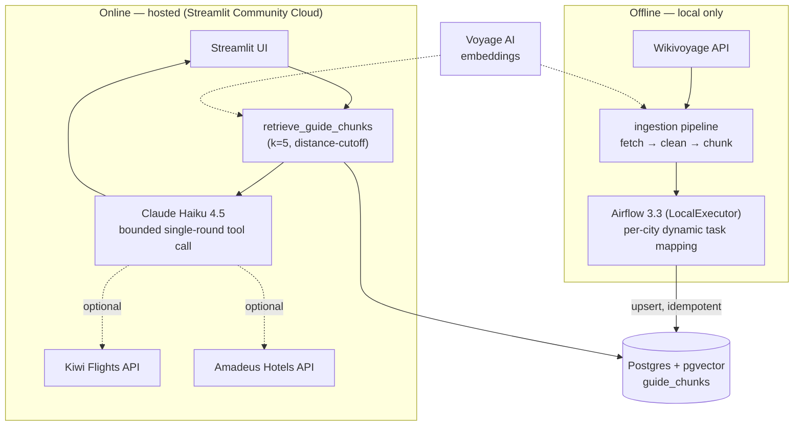

# Travel Planner — RAG Portfolio Project

A Streamlit travel-itinerary generator grounded in retrieval-augmented generation over
Wikivoyage city guides, backed by a Postgres/pgvector store, an Airflow-orchestrated
ingestion pipeline, and live flight/hotel tool-calling.

**Read this as a system-design case study, not just a build log.** The sections below name
the alternative each major component was weighed against, why it lost, and the trade-off
accepted by the choice that won — several of which only surfaced once the system was run
against real data and real traffic, not assumed on paper. Full chronological decision log:
[docs/superpowers/specs/2026-08-22-rag-travel-planner-design.md](docs/superpowers/specs/2026-08-22-rag-travel-planner-design.md).

## Architecture



The offline/online split is a deliberate boundary, not an accident of deployment: ingestion
and Airflow never run in the hosted environment — the hosted app only ever *reads*
`guide_chunks`. That keeps the live-facing system's failure surface small (a Voyage or
Wikivoyage outage during ingestion can't take down the query path) and matches how a
real production RAG system would separate a batch/streaming ingestion plane from an
online serving plane.

## Key decisions

### 1. Grounding: RAG, not a bare LLM call
A direct prompt to an LLM would answer travel questions too, hallucination risk and all.
For a system meant to demonstrate data infrastructure, not just LLM wrapping, retrieval
was non-negotiable: every itinerary claim needs to be traceable to a source chunk (the
"Sources:" line in every response), and the LLM must say so explicitly when nothing local
was found rather than quietly falling back to unverified general knowledge.

### 2. Vector store: Postgres + pgvector, not a dedicated vector database
Considered: Pinecone, Weaviate, Milvus. At this corpus's scale (low thousands of chunks),
a dedicated vector database solves a scaling problem this system doesn't have. Colocating
vectors and relational metadata in one Postgres instance means one connection story, one
backup/SSL/access-control story, one thing to operate — not two. HNSW indexing still gives
correct approximate-nearest-neighbor search at this scale; the trade-off is a decision to
revisit only if the corpus reaches the low millions of vectors or sees heavy concurrent
query load, neither of which applies here.

### 3. Orchestration: Airflow, not Dagster
Dagster's asset-based model maps more cleanly onto a linear ETL and is lighter to run
locally — genuinely the better technical fit for this project's actual shape. Airflow was
chosen anyway for its much stronger footprint in data-engineering job postings; naming the
trade-off explicitly (rather than pretending it was the "objectively correct" pick) is
itself the point of an architecture review. The cost of that choice was paid immediately:
Airflow 3's heavier local footprint, a dedicated `Dockerfile.airflow`/
`requirements-ingestion.txt` to keep its large, strictly-pinned dependency tree isolated
from the app's own, and a real concurrency bug (§7) that a lighter orchestrator's simpler
execution model likely wouldn't have surfaced the same way.

### 4. LLM + embeddings: two vendors, deliberately
Anthropic has no embeddings endpoint. Rather than defaulting to a single bundled-service
vendor (OpenAI offers both), Voyage AI was chosen specifically as Anthropic's own
recommended embeddings partner — an explicit decision to keep generation and retrieval as
independently-replaceable concerns. The codebase reflects that boundary structurally:
`clients/anthropic_client.py` and `clients/embeddings.py` are separate modules with
separate failure domains and separate rate limits, not one SDK wrapping both.

### 5. Hosting: Streamlit Community Cloud + Neon, evaluated against 4 alternatives

| Platform | Free tier reality | pgvector | Verdict |
|---|---|---|---|
| Render | real free tier, but cold starts (~1 min wake) | unconfirmed on managed Postgres | passed over on uncertainty |
| Railway | best-in-class pgvector support | free tier removed in 2023 | passed over on cost |
| Fly.io | none for new accounts | needs manual Docker image surgery | passed over on cost + effort |
| Supabase | free, native pgvector | hard 7-day inactivity pause, manual reactivation | rejected: bad failure mode for something a reviewer opens weeks apart |
| **Neon** (chosen) | free, **scale-to-zero with automatic resume** | native | no manual-intervention failure mode |

The deciding factor wasn't raw feature parity — several alternatives matched or beat Neon
on paper — it was which failure mode a reviewer would actually hit, and how it degrades.

### 6. Tool-calling: one bounded round, not an autonomous agent
Considered: let the model decide freely, in a loop, whether and when to call tools.
Rejected — for a live demo a reviewer times themselves interacting with, "the agent looped
or called the wrong tool" is a worse failure mode than "somewhat less impressive."
Deterministic RAG retrieval always runs first; exactly one function-calling round is
permitted after that. This is enforced as an architectural invariant in the code, not a
convention someone could accidentally violate: `rag/generation.py`'s follow-up API call
never receives a `tools` argument, so a second tool-calling round is structurally
impossible, not just discouraged.

### 7. Fault isolation: per-city dynamic task mapping, found by breaking it in production
The DAG's 5 stages (fetch → clean → chunk → embed → upsert) are each mapped independently
over the 5 cities via Airflow's dynamic task mapping, so one city's failure never blocks or
corrupts the others. `AirflowSkipException` marks *expected*, non-retryable failures
(a missing article) distinctly from genuinely transient ones (rate limits), which are left
to raise into Airflow's own retry policy — two different failure semantics handled two
different ways, on purpose.

This design was validated the hard way: LocalExecutor runs the 5 mapped `embed_batch`
instances *concurrently* by default, and 5 cities hammering Voyage's shared account-level
rate limit at once exhausted the embedding client's own retry budget faster than serial
execution ever did in earlier testing — a real problem invisible in any single-city test,
only surfacing at the fleet level. Fixed with a single-slot Airflow Pool pinning that one
task to serialized execution, without touching the other 4 stages' parallelism.

### 8. Retrieval tuning was measured, not assumed
The similarity cutoff separating "confident match" from "nothing relevant" started at 0.45,
set from a single manual spot check. A systematic 18-query evaluation harness
(`eval/run_eval.py`) later caught a real false negative — a genuine Paris match at 0.457
being silently excluded — with only a 0.019 margin against the nearest known false
positive. Retuned to 0.46 and reconfirmed at 18/18. The harness exists specifically so this
kind of regression is a one-command check going forward, not another one-off manual
spot check.

## System boundaries and constraints

- **Cost containment as a design constraint, not an afterthought**: every vendor choice
  (Claude Haiku over a larger model, Voyage's free tier, Neon over paid alternatives,
  Amadeus/Kiwi's official free self-service tiers over scraping) was made under an explicit
  zero-additional-cost budget, threaded through the whole stack rather than bolted on.
- **Dependency isolation as blast-radius containment**: the Airflow container's
  dependency set (`requirements-ingestion.txt`) is deliberately a strict subset of the app's
  (`requirements.txt`) — neither `streamlit` nor `anthropic` nor `amadeus` ever needs to
  resolve inside the orchestration container, and the reverse never needs Airflow's own
  constraint-pinned tree.
- **Secrets never touch git**: local dev uses `.env` (gitignored); the hosted app reads
  Streamlit Community Cloud's own secrets manager, exposed as real environment variables to
  the same `core/config.py`/`os.getenv()` code path — no separate secrets-handling branch
  for "local" vs "hosted."
- **Graceful degradation over hard failure**: every external call (Kiwi, Amadeus, Voyage,
  Wikivoyage) that can fail is wrapped to degrade to a documented fallback rather than
  crash the request — verified live, including one path (a missing Amadeus credential
  causing an unmocked `ValueError`) that no test had explicitly anticipated.

## How the architecture evolved

Each phase shipped a working, demoable state before the next added complexity — a
deliberate incremental-delivery discipline, not just a to-do list:

| Phase | Delivered | Status |
|---|---|---|
| 1 — Core RAG | Ingestion script, Postgres+pgvector, grounded generation | done, live-verified |
| 2 — Orchestration | Airflow DAG, per-city fault isolation, the concurrency fix in §7 | done, live-verified |
| 3 — Tool-calling | Bounded flight/hotel function-calling (§6); found and fixed 2 pre-existing bugs in the reused flight code along the way | done, live-verified (flights); hotels pending Amadeus signup |
| 4 — Deployment | Streamlit Community Cloud + Neon (§5) | done, live |
| 5 — Evaluation (stretch) | Retrieval hit-rate harness; found and fixed the tuning gap in §8 | done, 18/18 |

---

## Setup

```bash
cp .env.example .env
# edit .env: set ANTHROPIC_API_KEY, VOYAGE_API_KEY, and a POSTGRES_PASSWORD
```

### Bring up the database and Airflow

```bash
docker compose up -d --build
```

This starts two services:
- `postgres` — Postgres + pgvector, holding the app's `guide_chunks` table (database
  `travel_planner`)
- `airflow` — Airflow 3.3 in `standalone` mode (webserver/api-server + scheduler +
  triggerer in one process), holding its own metadata in a separate `airflow` database on
  the same Postgres server

**First-time only**, if the `postgres` volume already existed before Airflow was added (i.e.
you're resuming a Phase-1-only checkout): the `airflow` database won't be auto-created by
`db/init/02_airflow_db.sql` (Postgres only runs init scripts against a brand-new, empty data
volume). Create it once manually:

```bash
docker compose exec postgres psql -U $POSTGRES_USER -d travel_planner -c "CREATE DATABASE airflow;"
```

On a genuinely fresh `docker compose up` (new volume), this happens automatically.

### Run the ingestion pipeline

Either run it directly (no Airflow needed):

```bash
python -m venv .venv && source .venv/bin/activate   # .venv\Scripts\activate on Windows
pip install -r requirements.txt
python -m ingestion.run_ingest
```

...or trigger the Airflow DAG:

```bash
# one-time: create the pool that serializes embedding calls against Voyage's rate limit
docker compose exec airflow airflow pools set voyage_api 1 "Serialize Voyage AI embed calls"

docker compose exec airflow airflow dags unpause wikivoyage_ingest
docker compose exec airflow airflow dags trigger wikivoyage_ingest
```

Watch progress at the Airflow UI: **http://localhost:8080**. Both paths write to the same
idempotent `guide_chunks` table (upsert on `(article_id, chunk_index)`), so either can be
re-run safely without duplicating data.

**Airflow admin credentials** are auto-generated on first boot and printed to the logs:

```bash
docker compose logs airflow | grep -i password
```

### Run the app

```bash
streamlit run Home_Page.py
```

Fill in a destination, days, budget, interests, and travel style, then "Start Planning" —
the itinerary is grounded in retrieved Wikivoyage content for the 5 seed cities, with a
"Sources" line citing which guide sections were used. For any other destination, it falls
back to general knowledge with an explicit note that no local guide data was available.

## Structure

```
core/       config, Postgres connection, date helpers -- shared infra
clients/    Anthropic + Voyage AI client wrappers
providers/  Kiwi/Amadeus travel-data APIs + the Claude tool-calling glue over them
ingestion/  Wikivoyage fetch -> clean -> chunk -> embed -> store pipeline
rag/        retrieval + grounded generation
dags/       Airflow DAG (Airflow-container-only, see Setup)
eval/       retrieval hit-rate evaluation (see Evaluation)
tests/      mirrors the packages above; kept out: tests/dags (Airflow-only deps)
```
`Home_Page.py` and `pages/` stay at repo root — Streamlit's multipage convention requires
`pages/` to sit next to the entry script, and Streamlit Community Cloud's dashboard has
`Home_Page.py` configured as the app's main file outside the repo.

## Tests

```bash
pytest -q
```

Covers ingestion cleaning/chunking and RAG retrieval/generation, all pure-function or mocked
(no live DB/API calls, no Docker required). The Airflow DAG's own integrity test is isolated
to the Airflow container's dependency set (kept out of the app's `requirements.txt`
deliberately) and runs via:

```bash
docker compose exec airflow python -m pytest /opt/airflow/project/tests/dags -v
```

## Evaluation

```bash
python -m eval.run_eval
```

Scores `rag/retrieval.py`'s hit-rate against a labeled set of 18 queries (`eval/queries.py`)
mirroring the real query shape the app builds — 15 positive cases (5 cities × 3 query
variants each) plus 3 negative cases (never-ingested cities, which should retrieve nothing).
Requires the local Postgres populated (real DB + real Voyage API calls, not part of `pytest`).
See decision §8 for what this caught.

## Deployment

The hosted deployment uses two free-tier services — the ingestion pipeline (and Airflow
itself) stay local-only, per decision §5; the hosted app only ever *reads* the vector store.

### One-time setup

1. **Create a Neon project** and grab its connection details (host, port, database, user,
   password — Neon presents these as a single connection string).
2. **Create the schema on Neon**: run the contents of [db/init/01_init.sql](db/init/01_init.sql)
   against the new database (simplest via Neon's own SQL editor).
3. **Populate it** by running the ingestion script once, pointed at Neon via inline env var
   overrides (so your local `.env` never mixes with production credentials):
   ```bash
   POSTGRES_HOST=<neon-host> POSTGRES_PORT=<neon-port> POSTGRES_DB=<neon-db> \
   POSTGRES_USER=<neon-user> POSTGRES_PASSWORD=<neon-password> POSTGRES_SSLMODE=require \
   python -m ingestion.run_ingest
   ```
4. **Create the Streamlit Community Cloud app**: connect this GitHub repo, set the main
   file to `Home_Page.py`, and set the Python version to 3.11 under Advanced Settings.
5. **Add secrets** in the Streamlit Cloud dashboard (root-level `key = value`, not nested):
   `ANTHROPIC_API_KEY`, `VOYAGE_API_KEY`, `KIWI_API_KEY`, `AMADEUS_CLIENT_ID`/
   `AMADEUS_CLIENT_SECRET` (optional — the app degrades gracefully without them), and the
   Neon `POSTGRES_*` values including `POSTGRES_SSLMODE=require`.

## Project status

- **Phase 1 — Core RAG**: done. Ingestion script, RAG-grounded generation, live-verified.
- **Phase 2 — Airflow orchestration**: done. `wikivoyage_ingest` DAG, live-verified
  end-to-end (including idempotency across repeated runs).
- **Phase 3 — Live tool-calling** (flight/hotel search): done. Live-verified against the
  real Kiwi API and Claude; hotel search implemented but not yet live-verified end-to-end
  (Amadeus self-service signup still pending).
- **Phase 4 — Deployment**: done. Live on Streamlit Community Cloud + Neon; confirmed
  working with real flight tool-calling on the hosted app. Hotel search still pending
  Amadeus signup (degrades gracefully in the meantime).
- **Phase 5 — Retrieval evaluation** (stretch): done. 18/18 (100%) hit-rate; surfaced and
  fixed a real `max_distance` tuning gap in the process (see decision §8).
